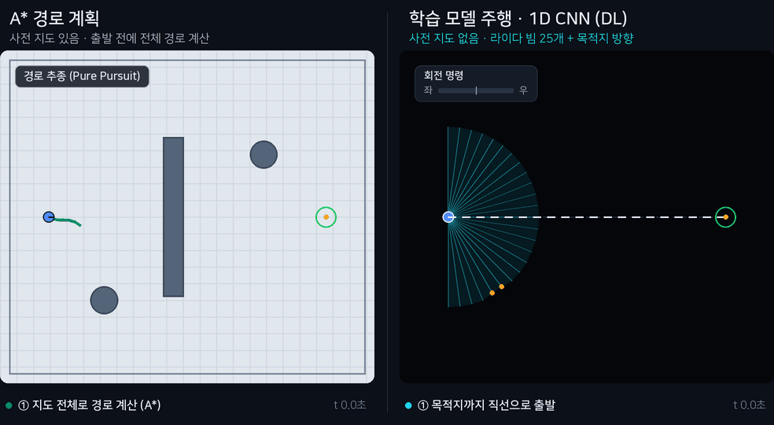
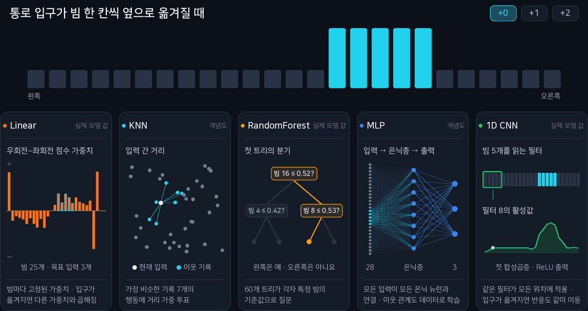
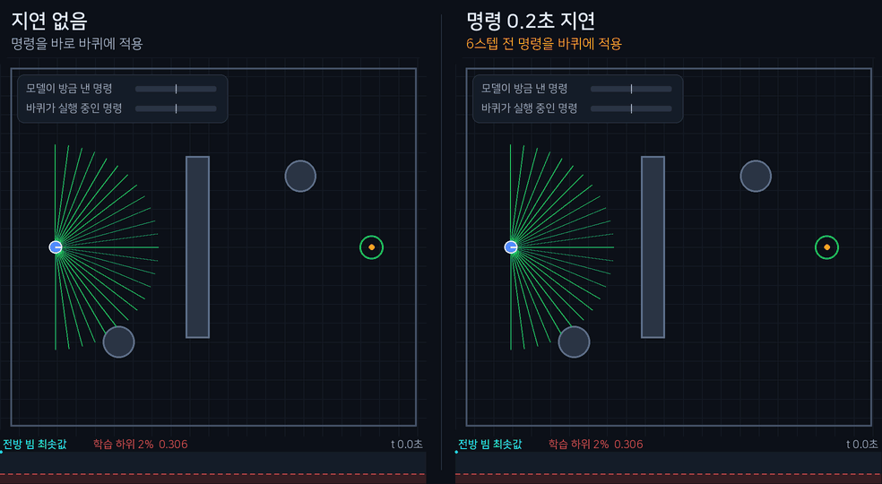

# 라이다로 길을 고르는 로봇

## 자율주행에 왜 모델을 쓸까?

벽 너머에 목적지가 있습니다. 지금 로봇은 왼쪽으로 돌아야 할까요, 오른쪽으로 돌아야 할까요? 같은 위치에 서 있더라도 출발 전에 어떤 정보를 알고 있느냐에 따라 풀어야 할 문제 자체가 달라집니다.

왼쪽 로봇은 출발하기 전부터 벽의 위치와 크기를 모두 알고 있습니다. A* 알고리즘은 전체 지도에서 이동 거리와 장애물과의 여유 거리를 함께 계산해 초록색 우회 경로를 한 번에 구합니다. 로봇은 주행 내내 이 경로 위의 앞선 지점을 따라가며 속도와 회전량을 조절하므로, 벽에 닿기 훨씬 전부터 자연스럽게 방향을 틉니다.

반면 오른쪽 로봇에는 지도가 없습니다. 어두운 영역은 아직 알지 못하는 공간이고, 밝게 비치는 부채꼴이 현재 라이다 빔 25개가 닿는 범위, 노란 점이 빔에 감지된 장애물 표면입니다. 흰 점선은 로봇에서 목적지까지 곧장 이은 선으로, 모델에 입력되는 목적지 방향을 보여 줍니다. 벽이 빔에 감지되면 모델이 학습한 방식대로 회전 명령을 내리고, 로봇이 움직일 때마다 목적지 직선도 새 위치에 맞춰 다시 그려집니다. 뒤에 희미하게 남는 선들이 그 변화의 흔적입니다.

> 오른쪽 모델은 A*처럼 전체 경로를 다시 계산하지 않습니다. 매 순간 라이다 거리 25개와 목적지 정보 3개만 보고 바로 다음 명령 하나를 정합니다. 노란 점이 잠시 남았다 사라지는 것은 이해를 돕기 위한 화면 효과일 뿐, 모델은 지나온 벽을 기억하지 않습니다.

### 규칙으로도 갈 수 있는데, 왜 학습을 시킬까요?

전체 지도가 있다면 왼쪽처럼 경로를 미리 계획하면 됩니다. 지도가 없더라도 ‘정면이 막히면 더 트인 쪽으로 돈다’ 같은 규칙을 직접 짤 수 있습니다. 하지만 더 트인 쪽이 목적지와 멀어지거나 막다른 길로 이어진다면, 상황에 맞는 예외 규칙을 끝없이 덧붙여야 합니다.

그래서 여기서는 접근 방식을 바꿔 봅니다. 여러 지형을 무사히 돌아간 주행 기록이 충분하다면, 사람이 조건문을 하나씩 작성하는 대신 그 기록에서 직접 행동을 배울 수 있을까요? 물론 학습을 거친다 해도 벽 너머의 보이지 않는 공간까지 알게 되는 것은 아닙니다.

## 주행 기록으로 모델을 어떻게 학습시킬까?

벽 앞에서 로봇이 속도를 줄이며 오른쪽으로 돌았다고 가정해 봅시다. 그 순간을 딱 멈춰 기록하면 학습 데이터 한 건이 만들어집니다.

> 입력값은 총 28개입니다. 라이다가 측정한 거리 25개에 목적지의 상대 방향(sin·cos) 2개와 정규화된 거리 1개를 더합니다.

> 같은 순간의 주행 명령도 함께 저장합니다. 선속도는 앞으로 얼마나 빠르게 나아갈지, 각속도는 어느 쪽으로 얼마나 크게 돌지를 나타냅니다.

위 그림은 데이터셋의 655번째 주행 기록입니다. 로봇의 정면이 위쪽을 향한다고 보면, 왼쪽 빔은 가까운 장애물에 막혀 짧게 끊기고 오른쪽 빔은 훨씬 길게 뻗어 있습니다. 이때 함께 기록된 각속도는 +0.57로 우회전 명령입니다. 그림에는 28개 입력 중 라이다 거리 25개만 나타냈지만, 실제 모델에는 목적지 정보도 함께 들어갑니다.

수집 탭에서 ‘데이터셋 자동 생성 시작 (실시간 주행)’을 누르면 로봇이 A* 경로를 따라 달리며 센서값과 주행 명령을 자동으로 기록합니다. 여러 맵의 데이터를 한꺼번에 모으려면 ‘샘플 3,000개 일괄 생성’을, 직접 조종한 기록을 담으려면 ‘수동 주행 데이터 수집 시작’을 누르면 됩니다.

학습 단계에서는 센서값과 목적지 정보를 모델에 넣고, 모델이 예측한 명령이 당시 기록된 주행 명령과 같아지도록 맞춥니다. 이처럼 시연 기록을 보고 상황에 맞는 행동을 익히는 방법을 모방학습이라고 하며, 입력과 행동을 일대일로 짝지어 학습하는 방식을 ‘행동 복제’라고 부릅니다.

### ‘오른쪽으로’와 ‘얼마나 오른쪽으로’의 차이

분류로 학습하면 모델은 좌회전·직진·우회전 중 하나를 선택하고, 앱은 그 선택에 미리 정해 둔 속도 명령을 적용합니다. 반면 회귀로 학습하면 모델이 선속도와 각속도를 연속적인 수치로 직접 예측합니다. 완만한 코너에서 ‘살짝만 돌기’와 ‘크게 돌기’를 세밀하게 구분해야 할 때 두 방식의 차이가 분명해집니다.

### 로봇 팔을 학습시킬 때 사람의 조작을 기록하는 이유

로봇 팔로 블록을 집어 올리는 상황을 생각해 봅시다. 작업이 끝난 뒤에야 블록을 제대로 들었는지 알 수 있다면, 그 결과만으로는 중간에 집게를 왼쪽으로 얼마나 옮겨야 했는지, 어느 시점에 닫아야 했는지 파악하기 어렵습니다. 반대로 사람이 로봇 팔을 원격 조종하면서 카메라 영상과 조작 명령을 함께 기록하면, 매 순간 필요한 세밀한 움직임까지 그대로 학습 데이터로 활용할 수 있습니다.

그림에서 집게가 닫히는 과정을 살펴보세요. 블록이 집게보다 왼쪽에 보이면 손목을 왼쪽으로 옮기고, 블록이 두 손가락 사이에 들어온 뒤에야 이동을 멈추고 집게를 닫습니다. 이처럼 작업 한 번에서도 여러 상황에 대한 조작 기록을 고루 얻을 수 있습니다. 부품을 떨어뜨릴 때마다 사람이 직접 다시 놓아 줘야 하는 실물 로봇 실험에서는 이러한 방식이 특히 큰 장점이 됩니다.

### 두 팔을 쓰거나 이동하면서 작업할 때

ALOHA 연구팀은 사람이 두 로봇 팔을 원격 조종해 배터리를 끼우는 과정을 기록했습니다. 한 손이 부품을 고정하는 동안 다른 손이 어느 시점에 움직이는지도 기록에 그대로 남습니다. 연구팀의 ACT 모델은 카메라 영상과 관절 위치를 입력받아 다음 몇 스텝의 관절 움직임을 한꺼번에 예측합니다. 위 애니메이션은 물체를 집는 원리를 단순화해 나타낸 것입니다.

[ALOHA 로봇 팔의 원격 조종 영상과 실험 결과](https://tonyzhaozh.github.io/aloha/)

Mobile ALOHA는 바퀴 달린 이동 플랫폼 위에 두 로봇 팔을 얹은 연구입니다. 냄비를 주방 수납장에 넣으려면 팔이 닿는 위치에 멈춰 선 뒤, 문을 열고 냄비를 밀어 넣어야 합니다. 연구팀은 작업마다 사람이 50회씩 직접 조종한 기록을 기존 양팔 작업 데이터와 함께 학습했습니다. 이동을 멈추는 시점과 팔을 뻗는 시점을 한 번의 시연 안에 함께 담아낸 사례입니다.

[Mobile ALOHA 연구의 이동·조작 실험](https://mobile-aloha.github.io/)

### 어떤 작업에서 모방학습이 유용할까?

부품이 늘 같은 자리에 놓여 있다면 이동 경로를 미리 정해 두고 로봇이 그 궤적만 따르게 제어하면 됩니다. 하지만 부품의 위치가 매번 조금씩 달라지면 집게를 닫아야 할 순간도 매번 바뀝니다. 이럴 때는 여러 위치에서 사람이 어떻게 집었는지 기록해 모델에 학습시킬 수 있습니다. 실제로는 학습 모델이 손목의 목표 위치를 정하고, 기존 관절 제어기가 그 위치까지 움직이는 식으로 두 방식을 결합해 쓰기도 합니다.

어떤 상황을 데이터로 모았는지도 중요합니다. 작업대 중앙에서 블록을 매번 잘 집더라도, 가장자리에서 한 번 미끄러진 뒤에는 어떻게 대처해야 할까요? 이때 필요한 것은 사람이 집게 위치를 다시 고쳐 잡아 블록을 집어 올리는 복구 기록입니다. 이런 데이터를 보강한 뒤에야 가장자리 상황에서도 안정적으로 집을 수 있는지 검증할 수 있습니다.

다시 주행 실험으로 돌아와 보면, 로봇 팔의 ‘물체 위치와 손목 명령’ 자리에 ‘라이다 거리와 속도 명령’이 들어갑니다. 이제 같은 주행 기록으로 다섯 모델을 학습시켜 봅시다. 처음 마주치는 코너에서도 적절한 회전을 골라내는 모델은 어느 쪽일까요?

## 다섯 모델은 같은 벽을 어떻게 읽을까?

통로 입구가 라이다 빔 한 칸만큼 옆으로 옮겨졌다고 생각해 봅시다. 사람 눈에는 여전히 비슷한 입구로 보이지만, 각 모델은 이 비슷한 상황을 서로 다른 방식으로 처리합니다.

위쪽 막대 25개는 각 라이다 빔의 거리입니다. 밝은 막대 다섯 개가 열린 입구를 뜻하며, 오른쪽으로 한 칸씩 이동합니다. 아래 다섯 카드에서 각 모델이 이 변화를 어떻게 받아들이는지 비교해 보세요.

### Linear · 입력을 가중합해 판단하기

각 입력에 고유한 가중치를 곱해 더하는 방식입니다. 회귀에는 릿지 회귀, 분류에는 로지스틱 회귀를 사용합니다. ‘정면 거리가 짧을수록 속도를 줄인다’ 같은 단순한 경향은 쉽게 표현하지만, 정면 거리가 같더라도 목적지 방향과 옆 공간의 조합에 따라 전혀 다른 회전이 필요한 상황에는 한계가 있습니다.

### KNN · 비슷한 주행 기록 찾기

KNN은 현재 입력과 가장 비슷한 과거 주행 샘플을 최대 7개 찾아냅니다. 각 입력을 표준화한 뒤 거리를 재고, 더 가까운 샘플의 주행 명령에 큰 가중치를 둡니다. 다만 학습 데이터에 비슷한 코너 상황이 드물면, 가장 가까운 샘플을 찾아도 현재 상황에 맞지 않는 회전을 고를 수 있습니다.

### RandomForest · 여러 조건을 조합하기

60개의 결정 트리가 각기 다른 조건으로 관측값을 나눈 뒤 결과를 종합합니다. 예를 들어 한 트리가 ‘정면이 가까운가?’를 먼저 묻고, 이어서 ‘오른쪽이 열려 있는가?’를 따질 수 있습니다. 기록 속에 담긴 거리와 방향의 조합을 얼마나 잘 활용하는지는 레이스에서 직접 확인할 수 있습니다.

### MLP · 거리와 목적지의 관계를 함께 배우기

여러 층으로 쌓은 신경망이 28개 입력을 폭넓게 조합합니다. 오른쪽에 빈 공간이 있어도 목적지가 왼쪽에 있으면 다른 명령을 내리는 식으로, 복합적인 관계를 학습할 수 있습니다. 어느 빔이 서로 이웃해 있는지도 별도 구조 없이 데이터의 패턴만으로 익힙니다.

### 1D CNN · 이웃한 빔의 모양 읽기

같은 필터를 이웃한 라이다 빔에 차례로 훑으며 모양을 추출한 뒤, 그 결과를 목적지 정보와 합칩니다. 여러 빔이 나란히 길어지는 ‘열린 틈’이 옆으로 조금 이동하더라도 같은 필터가 동일하게 반응할 수 있습니다. 그림의 1D CNN 칸 아래 그래프는 실제 학습된 첫 번째 필터의 반응으로, 입구가 옮겨진 칸 수만큼 반응 위치도 함께 이동합니다. 이런 구조가 실제로 유리한지는 처음 보는 맵에서 주행해 봐야 확인할 수 있습니다.

## 회전을 잘 맞히면 목적지에도 잘 도착할까?

검증 점수는 학습에 쓰지 않고 따로 떼어 둔 주행 샘플로 계산합니다. 분류 정확도는 기록된 행동과 예측이 일치한 비율이고, 회귀 MAE는 정규화된 두 속도 명령의 평균 절대 오차입니다. 이 프로젝트에서는 전체 샘플 중 약 20%를 무작위로 검증용으로 나누므로, 같은 주행에서 바로 이어진 순간들이 학습과 검증 양쪽에 나뉘어 들어갈 수 있습니다.

고정 맵 A에서는 목적지 직선 위의 원형 장애물을 피하는 모습을 볼 수 있습니다. 고정 맵 B에서는 여러 장애물 사이에서 선택한 통로에 따라 주행 결과가 달라집니다. 제공된 회귀 모델로 시험했을 때 A에서는 여섯 주행기 모두 도착했습니다. B의 동시 레이스에서는 라이다 회피 기준선이 18초 안에 도착하지 못했고 Linear와 KNN은 충돌했으며, RandomForest와 MLP, 1D CNN은 도착했습니다. 20맵 평가는 별도로 생성한 랜덤 맵에서 실행합니다.

20맵 평가는 다른 관점에서 모델을 검증합니다. 로봇이 매 순간 스스로 행동을 선택해 고정 비교 맵 20개의 목적지까지 실제로 완주할 수 있는지를 봅니다. 함께 달리는 ‘라이다 회피 기준선(BASE)’ 역시 지도 없이 학습 모델과 똑같은 28개 입력(라이다 거리 25개와 목적지 정보 3개)만 받습니다. 목적지 쪽으로 당기는 힘과 가까운 장애물에서 밀어내는 힘을 더해 진행 방향을 정하고, 정면 정중앙이 대칭으로 막히면 왼쪽으로 방향을 틀며, 앞쪽 여유가 짧아지면 속도를 줄이는 단순한 인공 퍼텐셜 필드(APF) 규칙입니다. 이 기준선은 단일 장애물은 충돌 없이 잘 피해 가지만, 우회 경로가 필요한 오목한 지형이나 좁은 통로에서는 국소 최솟값에 갇혀 시간을 넘기기 쉽습니다. 단순 반응 규칙과 A* 주행 기록으로 학습한 모델을 나란히 비교해 보면, 학습 모델이 국소 회피를 넘어 얼마나 유리한 우회 행동을 익혔는지 더 분명하게 드러납니다.

<!-- evaluation:start -->
### 저장된 평가 · 회귀 · 같은 맵 20개

| 주행 방식 | 검증 MAE | 도착 | 충돌 | 시간 초과 | 도달률 |
| --- | --- | --- | --- | --- | --- |
| 라이다 회피 기준선 | — | 17/20 | 0 | 3 | 85% |
| Linear | 0.0817 | 7/20 | 12 | 1 | 35% |
| KNN | 0.0455 | 16/20 | 4 | 0 | 80% |
| RandomForest | 0.0415 | 20/20 | 0 | 0 | 100% |
| MLP (DL) | 0.0516 | 20/20 | 0 | 0 | 100% |
| 1D CNN (DL) | 0.0445 | 20/20 | 0 | 0 | 100% |

라이다 회피 기준선은 맵 20개 중 17개에서 도착했고 한 번도 충돌하지 않았지만, 나머지 3개에서는 제한 시간 안에 도착하지 못했습니다. 학습 모델 중에서는 RandomForest, MLP, 1D CNN의 도착 횟수가 20회로 가장 많았습니다. RandomForest와 MLP (DL)의 검증 MAE는 각각 0.0415와 0.0516이었지만, 완주한 맵 수는 같았습니다. 이번 평가에서 도착 한 번은 도달률 5%p에 해당합니다.
<!-- evaluation:end -->

도달률이 같더라도 충돌과 시간 초과는 따로 살펴봐야 합니다. 충돌은 장애물에 부딪힌 경우이고, 시간 초과는 제한 시간 15초 안에 목적지에 닿지 못한 경우입니다. 표의 숫자만으로는 회전을 늦게 시작해서 부딪혔는지, 제자리를 맴돌다 시간을 넘겼는지 알 수 없습니다. 단일 주행 모드에서 정면 빔이 짧아질 때 회전 명령이 어느 시점에 바뀌는지 관찰하면 원인을 훨씬 명확하게 파악할 수 있습니다.

## 바퀴가 움직이면 다음 입력도 바뀐다

학습된 모델이 자동 주행 때보다 아주 조금만 늦게 회전해도 로봇은 벽에 더 가까워집니다. 그러면 바로 다음 순간 라이다가 측정하는 거리도 그만큼 짧아집니다. 즉 모델은 자신이 방금 내린 명령 때문에 학습 데이터에서는 드물었던 위험한 거리값을 다음 입력으로 받게 됩니다. 이처럼 움직인 결과를 다시 측정해 다음 명령을 결정하는 구조를 폐루프 제어라고 합니다. 한 순간의 회전 방향을 잘 맞히는 모델이라도 실제 주행 전체를 끝까지 완주하는지는 반드시 따로 검증해야 합니다.

두 로봇은 같은 모델로 같은 맵의 같은 출발점에서 주행합니다. 다만 오른쪽 로봇만 모델이 낸 명령이 6스텝(0.2초) 뒤에 바퀴로 전달됩니다. 반응이 늦어진 오른쪽 로봇은 점점 벽에 가까워지고, 정면 빔의 거리가 학습 데이터에서 거의 보지 못했던 수준(빨간 구간)까지 짧아집니다. 그 위기 상황에서 낸 수정 명령마저 다시 늦게 반영되면서 결국 벽에 부딪힙니다. 반면 지연이 없는 왼쪽 로봇의 정면 빔은 끝까지 빨간 구간에 들어가지 않습니다.

### 실제 로봇에서는 어디에서 시간이 걸릴까?

초속 0.5m로 달릴 때 방향 전환이 0.1초만 늦어져도 회전을 시작하는 위치가 약 5cm 밀립니다. 실제 로봇에서는 라이다 측정, 데이터 전달, 모델 추론, 바퀴 구동에 이르기까지 모든 단계에서 시간이 소요됩니다. 앱에 표시되는 추론 시간은 그중 모델이 주행 명령을 계산하는 구간의 지연 지표입니다.

### 이 실험으로 어디까지 말할 수 있을까?

이 앱의 20맵 평가는 2D 고정 장애물 환경에서 추가 센서 잡음 없이 실행됩니다. 실제 환경에서는 빛 반사가 약한 표면에서 거리값이 누락되거나 바닥에서 바퀴가 미끄러질 수 있습니다. 따라서 화면의 도달률을 볼 때는 ‘어떤 로봇이든 성공한다’기보다 ‘이 입력 구성과 이 조건의 맵에서 이만큼 도착했다’로 해석하는 편이 정확합니다.

이제 첫 번째 애니메이션으로 다시 돌아가 보세요. 오른쪽 로봇이 받는 정보는 노란 점까지의 거리와 목적지 방향뿐입니다. 그 숫자 하나하나가 어떻게 회전 명령으로 이어지고, 작은 지연이나 오차가 왜 다음 입력까지 연쇄적으로 바꾸는지 이제 한눈에 읽힐 것입니다.
