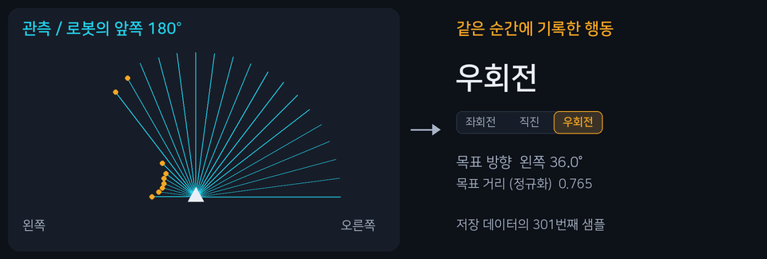
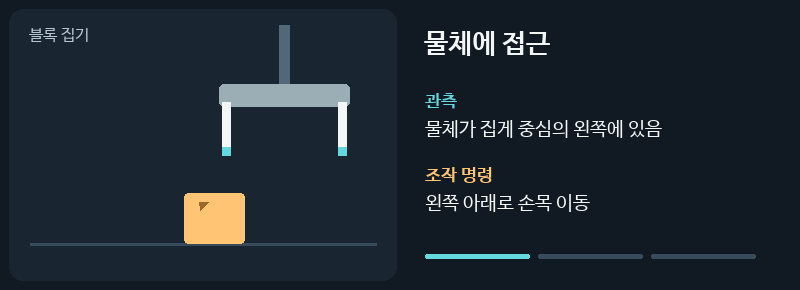

# 라이다로 길을 고르는 로봇

## 지도 기반 경로 계획과 센서 기반 회피

이 문서는 전체 지도를 사용하는 경로 계획과 현재 라이다 센서만 사용하는 학습 모델의 차이를 정리하고 모방학습의 데이터 구성, 모델별 동작 원리, 주행 평가 해석 기준을 설명합니다. 같은 출발점과 목적지라도 로봇이 전체 지도를 아는지, 현재 센서값만 받는지에 따라 제어 방식이 달라집니다.

왼쪽 로봇은 출발 전부터 모든 장애물의 위치와 크기를 알고 있습니다. A* 경로 계획기는 이동 거리와 장애물 여유 거리를 함께 반영해 초록색 전역 경로를 미리 계산합니다. 로봇은 이 경로 위의 앞선 추종점을 따라가므로 벽에 접근하기 전부터 우회를 시작합니다.

오른쪽 로봇에는 지도가 없습니다. 어두운 영역은 관측되지 않은 공간입니다. 밝은 부채꼴은 현재 라이다 25빔의 감지 범위이고 노란 점은 빔에 닿은 장애물 표면입니다. 흰 점선은 로봇에서 목적지까지 곧장 이은 방향 기준선입니다. 빔에 장애물이 감지되면 모델이 좌회전이나 우회전 행동을 선택합니다. 로봇 위치가 바뀌면 목적지 방향선도 매 스텝 갱신됩니다.

> 오른쪽 모델은 A*처럼 전역 경로를 재계산하지 않습니다. 매 스텝 라이다 거리 25개와 목적지 정보 3개만 입력받아 좌회전·직진·우회전 가운데 행동 1건을 출력합니다. 화면에 남는 노란 잔상은 시각화 효과입니다. 모델은 이전 상태를 기억하지 않습니다.

### 규칙 기반 회피의 한계와 학습 기반 접근

전체 지도가 있으면 A* 같은 경로 계획기를 사용하면 됩니다. 지도가 없을 때는 ‘정면이 막히면 빈 공간 쪽으로 회전’ 같은 규칙을 직접 작성할 수 있습니다. 그러나 넓은 공간이 목적지 반대편이거나 막다른 통로로 이어지는 예외가 늘어나면 규칙 관리가 급격히 복잡해집니다.

이 시뮬레이터는 예외 규칙을 수동으로 추가하지 않습니다. 대신 A* 교사가 다양한 장애물 배치를 통과한 주행 기록을 모아 모델이 직접 행동 분류 정책을 학습하도록 구성했습니다. 학습된 모델은 현재 관측에 대응하는 우회 행동을 근사합니다. 보이지 않는 벽 너머를 모르는 것은 이 모델도 마찬가지입니다.

## 주행 데이터와 모방학습

로봇이 A* 경로를 따라 주행하는 동안 일정한 기록 주기마다 센서 입력과 행동 라벨을 쌍으로 저장합니다. 실시간 자동 수집과 일괄 생성 모두 20 Hz 주기로 충돌 프레임을 제외하고 샘플을 기록합니다. 저장되는 각 샘플에는 28차원 관측 벡터와 3클래스 행동 라벨이 함께 들어갑니다.

> 입력(28차원): 전방 180° 라이다 거리 25개(정규화) + 목적지 상대 방향(sin, cos) 2개 + 정규화 거리 1개

> 학습 목표(3클래스 분류): 좌회전(0) · 직진(1) · 우회전(2)

위 그림은 도식 제작에 사용한 주행 데이터셋의 301번째 샘플 관측입니다. 로봇 정면을 위쪽으로 두었을 때 왼쪽 빔은 장애물에 막혀 짧고 오른쪽 빔은 길게 열려 있습니다. 이때 기록된 행동은 우회전입니다. 오른쪽 패널에는 모델에 함께 입력되는 목적지 방향(왼쪽 36.0°)과 정규화 거리(0.765)도 표시했습니다.

수집 탭의 ‘데이터셋 자동 생성 시작 (실시간 주행)’은 A* 교사 주행을 화면에 그리며 메모리에 샘플을 기록합니다. ‘샘플 3,000개 일괄 생성’은 여러 랜덤 맵에서 빠르게 샘플을 누적하고 ‘수동 주행 데이터 수집 시작’은 키보드 조종 기록을 쌓습니다. 수집한 데이터는 저장 버튼을 눌러 디스크에 파일로 기록할 수 있습니다.

학습 단계에서는 관측 벡터를 입력받아 당시 교사가 선택한 행동과 일치하도록 모델을 최적화합니다. 행동 복제(Behavioral Cloning)는 이렇게 전문가 시연에서 입력-행동 매핑을 직접 학습하는 모방학습 방식입니다.

### 행동 클래스와 고정 동작

학습 모델은 좌회전·직진·우회전 가운데 하나를 예측합니다. 시뮬레이터는 선택된 행동에 대응하는 고정 이동 동작을 적용해 로봇을 움직입니다. 출력 공간을 세 가지 이산 행동으로 단순화하면 혼동 행렬과 정밀도·재현율·F1 점수로 모델의 판단 성향을 직관적으로 비교할 수 있습니다.

### 실물 로봇의 조작 시연

로봇 팔로 물체를 집는 작업은 성공 여부가 마지막에야 판별됩니다. 이런 문제에서는 최종 결과만으로 중간 궤적의 미세한 위치 보정과 집게 닫힘 시점을 학습하기 어렵습니다. 사람이 원격 조종으로 시연하며 센서 입력과 조작 명령을 동시에 기록하면 각 시점의 세부 동작을 그대로 지도학습 데이터로 활용할 수 있습니다.

블록이 집게보다 왼쪽에 있으면 손목을 왼쪽으로 이동시키고 두 손가락 사이에 들어온 뒤에야 집게를 닫습니다. 한 번의 시연으로 다양한 상대 위치별 조작 샘플을 얻기 때문에 실패 시 사람이 물체를 다시 배치해야 하는 실물 환경에서 학습 비용을 줄이는 데 유리합니다.

### 양팔 조작과 이동 조작 사례

ALOHA 연구는 사람이 두 로봇 팔을 원격 조종해 배터리를 장착하는 작업을 기록했습니다. 한 팔로 부품을 고정하고 다른 팔로 조립하는 협응 타이밍이 데이터에 포함됩니다. ACT 모델은 카메라 영상과 관절 상태를 받아 다음 여러 스텝의 관절 궤적을 예측합니다.

[ALOHA 로봇 팔의 원격 조종 영상과 실험 결과](https://tonyzhaozh.github.io/aloha/)

Mobile ALOHA는 이동 베이스 위에 양팔을 결합한 연구입니다. 작업마다 50회의 원격 조종 시연 데이터를 기존 양팔 데이터와 함께 학습해 수납장 앞 정지 시점과 문 열기·수납 동작을 하나의 정책으로 연결했습니다.

[Mobile ALOHA 연구의 이동·조작 실험](https://mobile-aloha.github.io/)

### 모방학습의 적용 조건과 데이터 커버리지

물체 위치와 작업 조건이 반복적으로 고정된 환경에서는 사전 정의된 궤적 제어만으로 작업을 수행할 수 있습니다. 반대로 물체 위치나 장애물 배치가 매번 바뀌면 현재 관측에 따라 판단하는 정책이 필요합니다. 로봇 시스템에서는 학습 모델이 목표 지점이나 상위 명령을 생성하고 하위 제어기가 구동을 담당하는 혼합 구조도 하나의 설계 방식으로 활용됩니다.

성능은 수집한 데이터의 분포에 크게 좌우됩니다. 정상 경로 데이터만 모아 학습하면 주행 중 경로를 조금 벗어났을 때 학습하지 않은 관측으로 옮겨 가는 분포 이동(Distribution Shift)이 발생합니다. 위험 구간에서 벗어나는 복구 사례를 함께 수집하는 이유도 이 분포 이동 위험을 줄이기 위해서입니다.

이 시뮬레이터의 주행 문제 역시 같은 구조입니다. 입력은 28차원 센서·목적지 벡터이고 출력은 좌회전·직진·우회전 3클래스 행동입니다. 아래에서는 같은 데이터로 학습한 다섯 모델의 구조적 차이를 비교합니다.

## 다섯 모델의 입력 처리 방식

통로 입구가 라이다 빔 한 칸만큼 옆으로 이동했을 때 다섯 모델은 같은 입력 변화를 서로 다른 방식으로 처리합니다.

상단 25개 막대는 합성된 라이다 빔 거리이고 밝은 5개 막대가 열린 통로입니다. 통로가 오른쪽으로 한 칸씩 이동할 때 아래 패널에서 다섯 모델의 개념도와 저장된 모델에서 추출한 내부 반응 변화를 비교할 수 있습니다.

### Linear · 입력 가중합

로지스틱 회귀(LogisticRegression)는 28개 입력 각각에 클래스별 가중치를 곱해 합산한 뒤 세 행동의 점수를 비교합니다. 정면 거리가 짧을수록 회전 쪽 점수가 높아지는 단순한 선형 경계는 표현합니다. 그러나 같은 정면 거리에서도 목적지 방향과 측면 여유 공간의 조합에 따라 좌회전과 우회전을 달리 골라야 한다면 이런 비선형 조건은 표현하기 어렵습니다.

### KNN · 최근접 샘플 참조

입력을 표준화한 뒤 현재 관측과 가장 가까운 과거 주행 샘플을 최대 7개 찾습니다. 거리가 가까울수록 높은 가중치를 부여해 다수결로 행동을 산출합니다. 학습 데이터에 유사한 상황이 많으면 잘 동작하지만 드문 코너 형태나 복합 배치에서는 적절한 이웃을 찾지 못해 오판할 수 있습니다.

### RandomForest · 결정 트리 앙상블

60개의 결정 트리가 서로 다른 조건 분기로 관측 공간을 분할한 뒤 각 트리의 클래스 확률을 평균해 가장 높은 행동을 고릅니다. ‘정면이 가까우면서 오른쪽이 열려 있는가’ 같은 복합 조건 분기를 직접 표현할 수 있습니다.

### MLP · 다층 완전연결 신경망

은닉층을 거치며 28개 입력 전체의 비선형 조합을 학습해 좌회전·직진·우회전 세 클래스의 점수를 계산합니다. 라이다 거리 분포와 목적지 방향 간의 복합적인 관계를 비선형 결정 경계로 근사합니다. 다만 이웃한 라이다 빔의 인접 순서는 구조에 명시되어 있지 않아 데이터만으로 학습합니다.

### 1D CNN · 인접 빔 합성곱

1차원 합성곱 필터가 이웃한 라이다 빔을 따라 이동하며 국소 형태(열린 틈, 벽 모서리)를 추출한 뒤 목적지 특징 3개와 결합해 세 행동을 분류합니다. 열린 통로가 몇 칸 옆으로 이동해도 동일한 필터가 같은 패턴으로 반응합니다. 그림의 1D CNN 하단 그래프는 첫 번째 합성곱 층에서 가장 강하게 반응한 필터(필터 8)의 활성 위치가 입구 이동에 맞춰 함께 이동하는 모습입니다.

## 검증 점수와 실제 주행 성능의 차이

검증 점수는 전체 데이터 중 20%를 분리하여 행동 일치율(검증 정확도, %)로 계산합니다. 무작위 분할 특성상 같은 에피소드의 인접 프레임이 훈련과 검증에 나뉘어 포함될 수 있습니다. 그래서 검증 정확도만으로는 실제 주행 성능을 단정할 수 없습니다.

고정 맵 A(기본 회피)는 장애물 4개 중 원형 장애물 1개가 직진 경로를 막는 기본 테스트입니다. 고정 맵 B(복합 난코스)는 여러 장애물 사이에서 통로를 선택해야 하는 복잡한 환경이며 동시 레이스에는 18초 제한이 적용됩니다. 저장소에는 학습 완료 모델이 기본 포함되지 않으므로 직접 학습한 모델로 비교합니다. 저장소에 포함된 20맵 평가 CSV를 생성한 분류 체크포인트로 실행하면 맵 A는 6개 주행기가 모두 완주합니다. 반면 맵 B에서는 라이다 회피 기준선과 Linear·KNN이 충돌하고 RandomForest·MLP·1D CNN이 완주합니다.

20맵 평가에는 별도로 생성한 고정 비교 맵 20개를 15초 제한으로 사용합니다. 각 맵에서 로봇이 처음부터 끝까지 스스로 주행해 목적지에 도달하는 비율을 측정합니다. 현재 앱에서 새 평가를 실행할 때 함께 비교하는 ‘라이다 회피 기준선(BASE)’은 무상태 인공 퍼텐셜 필드(APF) 규칙입니다. 지도 없이 동일한 28차원 입력만 사용해 목적지 방향 인력과 근접 장애물 척력을 합산한 뒤 학습 모델과 같은 좌회전·직진·우회전 3가지 행동 중 하나를 고릅니다. 단순 장애물은 잘 피하지만 정교한 감속 없이 고정 회전 동작으로 움직이므로 좁은 통로나 복잡한 배치에서는 충돌할 수 있습니다. 이를 학습 모델과 나란히 비교하면 단순 반응 규칙 대비 모방학습의 우회 성능을 확인할 수 있습니다.

<!-- evaluation:start -->
### 저장된 평가 · 같은 맵 20개

| 주행 방식 | 검증 정확도 | 도착 | 충돌 | 시간 초과 | 도달률 |
| --- | --- | --- | --- | --- | --- |
| 라이다 회피 기준선 | — | 18/20 | 2 | 0 | 90% |
| Linear | 65.3% | 11/20 | 7 | 2 | 55% |
| KNN | 82.0% | 19/20 | 0 | 1 | 95% |
| RandomForest | 87.1% | 20/20 | 0 | 0 | 100% |
| MLP (DL) | 80.7% | 20/20 | 0 | 0 | 100% |
| 1D CNN (DL) | 83.7% | 20/20 | 0 | 0 | 100% |

라이다 회피 기준선은 맵 20개 중 18개에서 도착했고 나머지 2개에서 충돌했습니다. 학습 모델 중에서는 RandomForest, MLP, 1D CNN의 도착 횟수가 20회로 가장 많았습니다. MLP (DL)과 RandomForest의 검증 정확도는 각각 80.7%와 87.1%였지만 완주한 맵 수는 같았습니다. 이번 평가에서 도착 한 번은 도달률 5%p에 해당합니다.
<!-- evaluation:end -->

실패 유형은 충돌(장애물 접촉)과 20맵 평가의 시간 초과(15초 내 미도달)로 구분해 해석해야 합니다. 도착 또는 충돌 시 종료되는 단일 주행 모드에서는 정면 거리가 줄어드는 시점의 행동 확률 변화도 함께 확인해야 합니다. 집계 표만으로는 회전 지연에 의한 충돌인지 국소 정체로 인한 시간 초과인지 구분되지 않습니다.

## 폐루프 오차 누적과 실물 적용 시 고려 사항

모델이 교사보다 조금 늦게 회전하면 로봇이 벽에 더 가까워지고 다음 스텝의 라이다 입력도 학습 데이터에서 드문 근접 거리로 바뀝니다. 이처럼 현재 출력이 다음 입력 분포를 바꾸는 구조를 폐루프(Closed-loop) 제어라고 합니다. 이 구조에서는 오프라인 검증 정확도와 별도로 실제 폐루프 주행 평가가 필수입니다. 단일 프레임 오차가 작아도 주행 중 작은 오차가 누적되면 충돌로 이어질 수 있습니다.

위 비교는 같은 모델·같은 맵에서 제어 지연 유무만 바꾼 결과입니다. 오른쪽 로봇은 행동이 6스텝(0.2초) 늦게 적용되면서 벽에 지나치게 근접해 정면 7개 빔의 최솟값이 학습 데이터 하위 2% 기준선 아래로 내려가 빨간 구간에 진입합니다. 뒤늦은 회전 행동마저 지연되어 결국 충돌합니다. 지연이 없는 왼쪽 로봇은 안전 거리를 유지하며 통과합니다.

### 제어 지연의 구성 요소

0.5 m/s로 이동하는 로봇에서 제어가 0.1초 지연되면 회전 시작 지점이 약 5 cm 밀립니다. 실제 로봇에서는 센서 스캔, 통신, 모델 추론, 모터 구동 전 구간에서 지연이 합산됩니다. 앱에 표시되는 추론 시간(ms)은 학습 모델의 행동 예측 함수(predict_action) 호출에 걸리는 평균 시간으로 입출력 변환과 모델 연산 구간을 함께 반영합니다(라이다 회피 기준선은 0.01 ms 고정값으로 표시됩니다).

### 시뮬레이션 결과의 해석 범위

20맵 평가는 2D 정적 장애물과 무잡음 센서 조건에서 수행됩니다. 도달률 수치는 일반화된 실물 성능보다는 현재 입력 구성과 시뮬레이션 조건에서 모델 간 성능을 비교하는 상대 기준으로 해석해야 합니다. 실제 환경에서는 여기에 반사율 저하로 인한 라이다 결측, 바퀴 슬립, 동적 장애물 같은 변수가 더해집니다.
