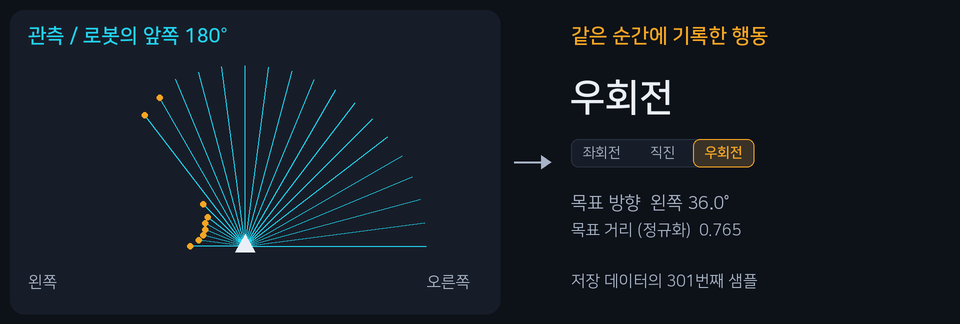
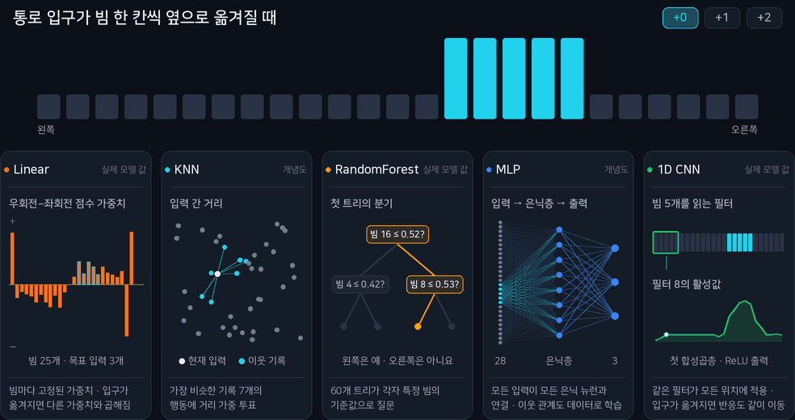
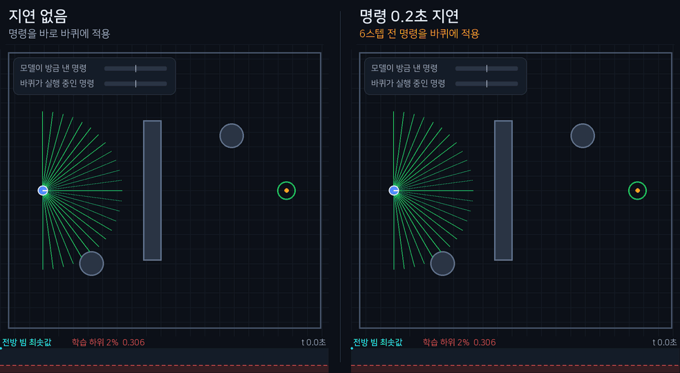

# LiDAR 주행 머신러닝 학습 가이드

이 문서는 머신러닝과 시뮬레이터 구현을 처음 접하는 독자를 위한 학습 자료입니다. `lidar-avoidance-ml` 프로젝트의 동작 원리를 데이터 수집부터 평가까지 순서대로 설명하며, 발표 질의응답 준비에 필요한 내용을 함께 정리합니다. 각 개념은 표준 용어, 정의, 프로젝트의 실제 수치 예시 순서로 설명합니다. 현재 프로젝트는 로봇의 전진 선속도(`v`)와 회전 각속도(`w`)를 연속 실수로 예측하는 회귀 방식을 제거하고, 좌회전(`0`)·직진(`1`)·우회전(`2`) 중 하나를 고르는 **3클래스 분류** 전용 구조로 단순화했습니다.

---

## 1. 이 프로젝트는 무엇을 하는 프로그램인가

이 시뮬레이터는 사전 지도 정보가 없는 로봇이 라이다(LiDAR) 거리값 25개와 목적지 방향·거리 3개(총 28개 입력)만으로 장애물을 회피해 목적지에 도달하는 행동 정책을 학습하는 **모방학습 실험 환경**입니다.

- **전역 지도 기반 교사 정책** (`AStarTeacher`): A\*는 지도를 격자로 나눈 뒤 출발점부터 목적지까지 이동 거리와 장애물 근접 페널티를 합산한 최소 비용 격자 경로를 계산하는 경로 탐색 알고리즘입니다([expert.py:194-216](../expert.py#L194-L216)). 계산된 격자 경로는 추종 전에 2회 평활화(smoothing)되며([expert.py:233-246](../expert.py#L233-L246)), 격자 탐색이 경로를 찾지 못하면 출발점과 목적지를 직접 잇는 직선 구간이 경로로 사용됩니다([expert.py:218-220](../expert.py#L218-L220)). 교사 정책은 이 경로를 연속 전진 속도(`v`)와 회전 각속도(`w`)로 추종하고, 매 스텝의 `w`를 임계값 `±0.28 rad/s` 기준으로 좌회전·직진·우회전 행동 라벨로 변환해 학생 모델의 학습 라벨로 제공합니다([expert.py:47-53](../expert.py#L47-L53), [expert.py:288-292](../expert.py#L288-L292)). 다만 전역 지도를 사용하더라도 벽에 근접한 위치에서 벽 방향으로 출발하는 초기 자세에서는 충돌이 발생할 수 있습니다.
- **센서 입력 기반 학생 모델** (머신러닝·딥러닝 모델 5종): 실제 로봇은 처음 주행하는 공간의 사전 지도 정보 없이 동작해야 하는 경우가 많습니다. 학생 모델은 지도 정보 없이 라이다(LiDAR) 거리값 25개와 목적지 방향·거리 3개만 입력받아 교사 정책의 행동 라벨을 예측하도록 학습합니다.
- **모방학습과 행동 복제** (Imitation Learning · Behavioral Cloning): 모방학습은 전문가의 시연으로부터 정책을 학습하는 방법을 통칭하며, 이 프로젝트는 그중 행동 복제 방식을 사용합니다. 행동 복제는 전문가 정책의 주행에서 (입력, 행동) 쌍을 수집하고 이를 지도학습 데이터로 사용해 정책을 학습하는 방법입니다. 이 프로젝트에서는 A\* 교사 정책의 주행 중 관측 `obs`(28차원)와 교사 행동 라벨 `action`을 샘플 단위로 기록하며(현재 로컬 데이터셋 기준 6,000샘플), 학생 모델은 이 쌍으로 `obs → action` 분류를 학습합니다.
- **학습과 추론**: 학습(훈련)은 수집한 데이터로 모델이 예측에 사용할 내부 구성 요소를 정하는 단계입니다. 그 대상은 모델마다 다르며, `Linear`·`MLP`·`1D CNN`은 가중치와 편향 같은 파라미터를 조정하고, `RandomForest`는 결정 트리의 분기 규칙과 임계값을 학습하며, `KNN`은 표준화 통계와 함께 훈련 샘플 전체를 저장합니다([model.py:456-485](../model.py#L456-L485)). 추론은 학습이 끝난 모델에 새 관측 입력을 넣어 행동을 예측하는 단계입니다.
- **3클래스 분류** (Multi-class Classification): 클래스는 모델이 출력할 수 있는 이산 범주입니다. 이 프로젝트의 모델은 매 스텝 좌회전(`0`), 직진(`1`), 우회전(`2`) 가운데 하나를 출력합니다. 시뮬레이터는 선택된 행동에 고정 `(v, w)` 명령을 적용합니다. 예를 들어 좌회전은 `v = 0.72 × 200 = 144 px/s`, `w = -0.82 × 2.9 ≈ -2.38 rad/s`입니다([simulator.py:82-86](../simulator.py#L82-L86)).
- **규칙 기반 비교 기준선** (`라이다 회피 기준선`, APF): 머신러닝 모델의 효과를 비교하기 위한 대조군입니다. APF(인공 퍼텐셜 필드, Artificial Potential Field)는 목적지 방향의 단위 인력 벡터와 근접 라이다 빔의 제곱 척력 벡터를 합산해 진행 방향을 정하는 규칙 기반 제어 방식입니다([expert.py:56-104](../expert.py#L56-L104)). 학습 없이 학생 모델과 동일한 28차원 입력만 사용해 같은 3가지 행동 중 하나를 선택합니다.

---

## 2. 1단계: 모델 입력 28개와 학습용 행동 라벨

### 2-1. 28차원 입력, 정규화, 저장 파일 형식(`NPZ` · `CSV`)

이 모델은 화면 이미지가 아니라 숫자 28개만 입력받습니다.

- **28차원 입력** (`obs`): 한 시점의 관측(observation)을 길이 28의 실수 벡터로 표현한 값입니다. 벡터의 원소가 28개이므로 28차원 입력이라고 합니다([simulator.py:20](../simulator.py#L20)).
- **정규화** (Normalization): 입력 항목마다 값의 범위가 다르면(예: `0 ~ 700` px와 `-1 ~ +1`) 범위가 큰 항목이 거리 계산과 가중치 학습에 과도한 영향을 줍니다. 정규화는 각 입력값을 `0 ~ 1` 또는 `-1 ~ +1` 범위로 변환하는 전처리입니다.
- **저장 파일 형식** (`NPZ` · `CSV`): 데이터셋을 저장하면 두 파일이 함께 생성됩니다([dataset.py:128-146](../dataset.py#L128-L146)). NPZ(`*.npz`)는 NumPy 배열을 압축 저장하는 이진 파일이며 `obs`(입력, 모양 `N × 28`)와 `actions`(행동 라벨, 모양 `N`) 두 배열만 담습니다([dataset.py:132](../dataset.py#L132)). 에피소드 번호나 맵 시드 같은 경계 정보는 저장하지 않습니다. CSV(`*.csv`)는 쉼표로 값을 구분한 텍스트 파일이며 스프레드시트나 텍스트 편집기에서 확인할 수 있도록 입력 28열(소수점 넷째 자리)과 행동 라벨 `action` 1열, 총 29열을 기록합니다.

저장된 1샘플은 추론 입력 28개와 학습용 행동 라벨 1개, 총 29개 값으로 구성됩니다([simulator.py:18-36](../simulator.py#L18-L36), [simulator.py:530-550](../simulator.py#L530-L550)).

- **1~25번째 값 · 라이다(LiDAR) 거리값 25개** (`beam_0` ~ `beam_24`): 라이다는 레이저를 발사하고 반사 신호로 장애물까지의 거리를 측정하는 센서입니다. 시뮬레이터는 로봇 전방 180° 시야에 빔 25개를 `7.5°` 간격으로 배치하고([simulator.py:354](../simulator.py#L354)), 각 거리를 최대 측정 거리 `260 px`(화면 픽셀 단위)로 나누어 `0.0 ~ 1.0` 범위로 정규화합니다. 예를 들어 `130 px` 거리의 장애물은 `130 ÷ 260 = 0.5`입니다. 시뮬레이터 기본 설정은 센서 측정 잡음을 반영하기 위해 가우시안 잡음(`noise_std=0.004`)을 더한 뒤 값을 `0.0 ~ 1.0` 범위로 클리핑하며([simulator.py:348](../simulator.py#L348), [simulator.py:531-533](../simulator.py#L531-L533)), 20맵 벤치마크는 잡음 없이(`noise_std=0.0`) 실행합니다([model.py:881](../model.py#L881)). 따라서 반올림하지 않은 `NPZ` 관측에서 `1.0`은 `260 px` 이내에 장애물이 없거나, `260 px` 직전 장애물의 값이 잡음으로 `1.0` 이상이 되어 클리핑된 경우입니다. `CSV`는 각 입력값을 소수점 넷째 자리로 기록하므로([dataset.py:145](../dataset.py#L145)), `0.99996`처럼 `1.0`보다 약간 작은 값도 `1.0000`으로 표시됩니다.
- **26~27번째 값 · 목적지 방향 2개** (`goal_sin`, `goal_cos`): 목적지 방향을 각도 1개로 입력하면 실제 차이가 `2°`인 `1°`와 `359°`가 수치상 `358` 차이로 표현됩니다. 이를 피하기 위해 로봇 기준 목적지 방향의 좌우 성분(`sin`, `-1 ~ +1`)과 전후 성분(`cos`, `-1 ~ +1`) 두 값으로 나누어 저장합니다.
- **28번째 값 · 목적지까지의 남은 거리 1개** (`goal_dist`): 로봇에서 목적지까지의 픽셀 거리를 `700 px`로 나누고 `1.0`을 상한으로 클리핑한 값입니다. 같은 전방 방향 `100 px` 거리에 벽이 있을 때, 목적지가 `50 px`(벽 앞)에 있으면 우회 없이 직진해 도달할 수 있고 `200 px`(벽 뒤)에 있으면 미리 우회를 시작해야 합니다. 모델 입력에서는 벽 거리가 `100 ÷ 260 ≈ 0.385`, 목적지 거리가 `200 ÷ 700 ≈ 0.286`처럼 서로 다른 기준(`260 px`, `700 px`)으로 정규화됩니다. 따라서 두 값의 단순 대소 비교로는 벽과 목적지의 앞뒤 관계를 판정할 수 없습니다. 모델은 학습 데이터에서 두 항목의 관계를 반영하는 방식을 얻으며, 그 방식은 모델마다 다릅니다. `Linear`·`MLP`·`1D CNN`은 두 입력의 스케일 차이를 반영한 가중치를 학습하고, `KNN`은 표준화된 입력 공간의 거리로 두 값이 비슷한 훈련 샘플을 찾으며, `RandomForest`는 각 입력에 대한 결정 트리의 분기 임계값을 학습합니다.
- **29번째 값 · 학습용 행동 라벨 1개** (`action`): `0`은 좌회전, `1`은 직진, `2`는 우회전입니다. 이 값은 학습 시 정답 라벨로만 사용하며 추론 입력에는 포함되지 않습니다. 자동 수집에서는 A\* 교사 정책의 행동 라벨이, 수동 수집에서는 사용자가 키보드로 입력한 행동이 저장됩니다.



위 그림은 도식 제작 당시 사용한 12,000샘플 데이터셋의 301번째 샘플(우회전)입니다. 사용자가 앱에서 새 데이터셋을 수집해 `data/dataset.npz`를 덮어쓰면 같은 번호라도 장면과 라벨이 달라집니다. 예를 들어 현재 로컬의 6,000샘플 데이터셋에서는 301번째 샘플이 좌회전이며 도식 선택 조건(왼쪽 빔 중앙값 `≤ 0.40`, 오른쪽 빔 최솟값 `≥ 0.90`, 우회전)을 만족하는 첫 샘플은 2,314번째입니다([generate_guide_figures.py:664](../scripts/generate_guide_figures.py#L664)).

### 2-2. 목적지 방향의 `sin`·`cos` 인코딩 (각도 1개 입력의 불연속 문제)

목적지 방향은 로봇 기준 좌표계의 **단위 벡터**(길이 1인 벡터)로 표현할 수 있습니다. 단위 벡터의 좌우 성분이 `sin`, 전후 성분이 `cos`입니다.

- 정면 `0°` → 좌우 `0`, 전 `+1` ⇒ `(sin = 0.00, cos = +1.00)`
- 우측 전방 `45°` → 우측 `+0.71`, 전 `+0.71` ⇒ `(sin = +0.71, cos = +0.71)`
- 우측 `90°` → 우측 `+1`, 전후 `0` ⇒ `(sin = +1.00, cos = 0.00)`
- 좌측 `-90°`(또는 `270°`) → 좌측 `-1`, 전후 `0` ⇒ `(sin = -1.00, cos = 0.00)`
- 후방 `±180°` → 좌우 `0`, 후 `-1` ⇒ `(sin = 0.00, cos = -1.00)`

실제 코드([simulator.py:535-550](../simulator.py#L535-L550))는 먼저 로봇 진행 방향 기준 목적지의 상대 각도를 `-180° ~ +180°`(예: `359° → -1°`, `270° → -90°`) 범위로 정규화한 뒤 `math.sin`과 `math.cos`로 두 성분을 계산합니다.

- **단일 각도 입력(`0° ~ 360°`)의 불연속 문제**: `KNN` 훈련 샘플에 `1°`(정면, 직진)와 `270°`(좌측, 좌회전)가 있다고 가정합니다. 주행 중 `359°`(실제로는 정면) 입력이 들어오면 `KNN`은 수치 차이로 거리를 계산합니다. 이때 `359°`와 `1°`의 차이(`358`)가 `359°`와 `270°`의 차이(`89`)보다 크므로, 정면 목적지에 대해 좌회전 샘플이 최근접 이웃으로 선택될 수 있습니다. `Linear` 모델도 각도 입력에 행동별 가중치 1개를 선형으로 적용하므로 수치상 양 끝에 있는 `1°`와 `359°`를 같은 직진 구간으로 분류하기 어렵습니다.
- **샘플 수 증가로 해결되지 않는 한계**: 데이터가 충분하면 `KNN`과 `RandomForest`(임계값 분기 기반)는 `358°`·`359°` 주변 샘플을 이용해 해당 구간을 부분적으로 올바르게 분류할 수 있습니다. 그러나 3클래스 `Linear` 모델은 행동마다 가중치 벡터 1개와 편향 1개(총 3쌍)를 학습하므로, 다른 입력을 고정하면 각 행동의 점수가 최대가 되는 영역은 각도 축 위의 연속 구간 하나로 제한됩니다. 따라서 양 끝(`1°`, `359°`)에서 직진 점수가 최대이고 가운데(`180°`)에서 회전 점수가 최대인 결정 경계를 표현할 수 없습니다. `KNN`도 각도 1개를 쓰는 27개 입력(라이다 25개, 각도 1개, 거리 1개)에서는 원시 각도의 스칼라 차이가 순환 경계 양쪽의 근접성을 표현하지 못하므로 `1°`와 `359°`를 인위적으로 먼 값으로 계산합니다. 그 결과 샘플이 희소한 코너 조합에서는 경계 반대편의 유사 샘플이 이웃 후보에서 밀려나기 쉬워 데이터 효율이 떨어집니다.
- **`-180° ~ +180°` 범위 변환의 한계**: `359° → -1°`로 변환하면 정면(`0°`) 부근은 연속이 되지만 불연속 경계가 후방(`-180° ↔ +180°`)으로 이동합니다. 목적지가 후방 `+179°`에 있을 때 로봇이 장애물을 회피하며 `2°` 더 회전해 `-179°`가 되면 입력값이 한 스텝에 `358`만큼 불연속적으로 변합니다. 반면 `(sin, cos)` 표현에서는 `+179°`와 `-179°`에 해당하는 두 단위 벡터 사이의 유클리드 거리가 약 `0.0349`(반올림 좌표 `(+0.02, -1.00)`과 `(-0.02, -1.00)` 기준 `0.04`)이므로 전 방향(360°)에서 불연속 구간이 없습니다.
- **규칙 기반 코드와 머신러닝 모델의 차이**: 규칙 기반 A\* 교사 코드([expert.py:267](../expert.py#L267))는 나머지 연산(`%`)으로 각도를 `-π ~ +π` 범위로 래핑(wrapping)해 직접 계산합니다. 반면 머신러닝 모델은 입력값을 선형 결합, 거리 계산, 임계값 분기 등으로 처리하므로, 입력 표현에 주기성이 없으면 각도의 `360°` 주기성이 입력 공간에 나타나지 않아 경계 양쪽의 값을 가까운 값으로 처리하기 어렵습니다. 따라서 모델 입력 단계에서 `math.sin`과 `math.cos` 두 줄([simulator.py:542-543](../simulator.py#L542-L543))로 각도를 연속 좌표로 변환합니다.

---

## 3. 2단계: 데이터 수집 방식과 로봇 이동 원리

### 3-1. 프레임 · 물리 스텝 · 기록 샘플과 세 가지 수집 방식의 차이

시뮬레이터의 시간 단위는 세 가지로 구분합니다. **프레임**(Frame)은 화면을 한 번 그리는 단위(`60 FPS` = 초당 60회)이고, **물리 스텝**(Physics Step)은 로봇의 위치와 각도를 한 번 갱신하는 계산 단위이며, **기록 샘플**(Sample)은 데이터셋에 저장되는 1행입니다. `Hz`(헤르츠)는 1초당 횟수를 뜻합니다.

`1 수집` 탭의 세 가지 수집 방식은 물리 스텝 간격, 기록 주기, 충돌 처리 방식이 서로 다릅니다([app.py:1145-1180](../app.py#L1145-L1180), [expert.py:308-355](../expert.py#L308-L355)).

- **샘플 3,000개 일괄 생성** (헤드리스 방식): 화면을 그리지 않는 헤드리스(Headless) 모드에서 고정 `0.05초`(`20 Hz`) 물리 스텝으로 루프를 실행합니다. 화면 출력이 없으므로 `clock.tick(60)`(현실 시간 1초와 가상 시간 1초를 맞추는 대기) 없이 연산을 연속 실행합니다. 모든 스텝이 유효 샘플로 채택되면 3,000샘플의 가상 주행 시간은 `3,000 × 0.05 = 150초`입니다. 로컬 환경 실측에서는 **약 `0.7초`** 만에 완료됩니다(측정 환경에 따라 달라짐). 충돌이 발생한 스텝은 저장하지 않고 다음 맵으로 전환합니다([expert.py:335-338](../expert.py#L335-L338)).
- **실시간 자동 생성**: 화면(`60 FPS`)에 A\* 교사 정책의 주행을 표시하면서 기록합니다. 누적 타이머가 `1/20초`(`0.05초`) 이상이 되면 1샘플을 저장하고 타이머를 `0`으로 초기화합니다. 이 방식은 임계값을 초과한 잔여 시간을 버리므로, `16 ms` 프레임이 반복되면 4프레임(`64 ms`)마다 1샘플이 기록되어 실제 기록 빈도는 약 `15.6 Hz`이고 유효 샘플 3,000개 수집에 현실 시간 약 `192초`가 걸립니다. 충돌이 발생한 프레임은 저장하지 않으며, 목적지 도달·충돌·`16초` 경과 시 다음 맵으로 전환합니다([app.py:1145-1160](../app.py#L1145-L1160)).
- **수동 주행 수집**: 사용자가 키보드 `W`(직진), `A`(좌회전), `D`(우회전) 또는 방향키를 누르는 동안 실시간 자동 생성과 동일한 타이머 방식으로 기록합니다. 키 입력이 없는 정지 상태는 기록하지 않습니다. 수동 주행에서는 충돌이 종료 조건이 아니므로 벽에 접촉해도 맵이 전환되지 않고 조작을 계속할 수 있으며, 충돌이 발생한 기록 주기에도 해당 프레임의 1샘플이 저장될 수 있습니다([simulator.py:480-489](../simulator.py#L480-L489)).

### 3-2. 맵 시드 분리와 데이터 누수 방지

- **시드** (Seed): 난수 생성기의 초기값으로, 무작위 맵 생성에 사용하는 정수입니다. 같은 시드와 같은 난이도를 넣으면 항상 동일한 장애물 배치가 만들어집니다. 난이도가 달라지면 같은 시드라도 배치가 달라질 수 있습니다.
- **데이터 누수**(Data Leakage) 방지: 데이터 누수는 평가 데이터의 정보가 학습 데이터에 포함되어 평가 지표가 실제 일반화 성능보다 높게 측정되는 현상입니다. 일괄 생성은 시드 `0~899`(난이도 `8~14`)를 사용합니다([expert.py:317-318](../expert.py#L317-L318)). 실시간 자동 생성에서 새로 만드는 랜덤 맵은 시드 `2000`번부터 증가합니다([app.py:65](../app.py#L65)). 단, 초기 화면 맵(시드 `101`)이나 고정 맵 A·B에서도 실시간 수집을 시작할 수 있습니다. 20맵 평가는 수집에 사용하지 않는 시드 `1000~1019`(난이도 `12` 고정)만 사용해 미학습 맵 성능을 측정합니다([model.py:880](../model.py#L880)).

### 3-3. 회전 각도 제어와 연속 2D 환경을 유지한 이유

- **고정 각속도와 누적 회전량**: 모델은 회전 각도를 수치로 출력하지 않습니다. 회전 행동의 각속도는 `0.82 × 2.9 ≈ 2.378 rad/s`(약 `136.2°/s`)로 시뮬레이터 `_ACTION_COMMANDS`에 고정되어 있습니다([simulator.py:82-86](../simulator.py#L82-L86)). 물리 스텝마다 방향각은 `θ ← θ + w × dt`로 갱신되므로([simulator.py:447](../simulator.py#L447)), 누적 회전량은 `Δθ = Σ(wᵢ × dtᵢ)`입니다. 여기서 `wᵢ`는 `i`번째 스텝에서 선택된 행동의 각속도(회전 행동 `±2.378 rad/s`, 직진 `0`)이고 `dtᵢ`는 해당 스텝의 간격입니다. 따라서 회전량은 회전 행동이 선택된 스텝 수만으로 정해지지 않고 각 스텝의 간격에 따라 달라집니다. 예를 들어 `우회전` 10스텝은 `60 Hz`(`dt = 1/60초`)에서 약 `22.7°`, `30 Hz`(`dt = 1/30초`)에서 약 `45.4°` 회전합니다. 대화형 앱은 프레임 경과 시간(최대 `0.05초`)을 `dt`로 사용하므로 프레임 속도가 변하면 같은 스텝 수에서도 회전량이 달라집니다([app.py:327](../app.py#L327)). `dt`가 `1/60초`로 고정된 조건을 가정하면 1스텝 회전량은 약 `2.27°`이고, `90°` 회전에는 약 `0.66초`, 즉 약 40스텝의 연속 `우회전`이 필요합니다. 이 수치는 고정 각속도에서 계산한 조건부 예시이며, 시뮬레이터에 회전 종료 시점을 정하는 별도 규칙은 없습니다. 회전 지속 여부는 매 스텝 모델이 갱신된 라이다·목적지 입력으로 선택한 행동에 따라 결정됩니다.
- **연속 2D 라이다 환경을 유지한 이유**: 현재 로봇의 2D 운동 갱신 수식은 [simulator.py:447-450](../simulator.py#L447-L450)의 3줄입니다. 2D 격자(grid) 미로로 바꾸면 BFS(너비 우선 탐색, 출발점에서 가까운 칸부터 차례로 탐색 범위를 넓히는 알고리즘)나 A\*처럼 지도를 직접 탐색하는 방법과의 차이가 줄어듭니다. 또한 연속 라이다 스캔과 제어 지연 같은 로봇 주행 특성을 실험하기 어려워집니다.

---

## 4. 3단계: 학습 준비와 5종 분류 모델의 계산 원리

### 4-1. 모델 학습 직전의 공통 준비 3가지

`2 학습` 탭에서 학습을 시작하면 모델에 들어가기 전 세 가지 준비 단계를 거칩니다([model.py:260-275](../model.py#L260-L275), [model.py:362-485](../model.py#L362-L485), [dataset.py:52-68](../dataset.py#L52-L68), [app.py:1532](../app.py#L1532)).

- **훈련셋(80%)과 검증셋(20%) 분할**: 검증셋(validation set)은 학습에 사용하지 않은 샘플로 일반화 성능을 추정하기 위한 데이터입니다. 현재 로컬 6,000샘플 데이터셋은 `seed=42`로 무작위 분할해 훈련셋 4,800개와 검증셋 1,200개로 나눕니다([model.py:260-264](../model.py#L260-L264)). 12,000샘플이라면 9,600개와 2,400개로 나뉩니다. 다만 무작위 분할은 같은 주행 에피소드의 인접 프레임을 훈련셋과 검증셋에 나누어 배치할 수 있습니다. 현재 6,000샘플 분할에서는 검증 1,200행 중 1,154행이 저장 순서상 훈련 행과 바로 인접해 있어, 검증 정확도가 독립된 에피소드에 대한 분류 정확도보다 높게 추정될 수 있습니다. 단, [dataset.py:132](../dataset.py#L132)는 `obs`와 `actions`만 저장하고 에피소드 경계를 저장하지 않으므로 저장 파일만으로는 같은 에피소드 내 누수의 정확한 규모를 측정할 수 없습니다(맵 전환 지점의 인접 두 행은 서로 다른 에피소드일 수 있습니다).
- **좌우 반전 증강** (Mirror Augmentation, 훈련셋 전용): 왼쪽 장애물을 오른쪽으로 회피하는 샘플을 좌우 반전하면 오른쪽 장애물을 왼쪽으로 회피하는 샘플이 됩니다. `2 학습 → 학습 설정`의 `좌우 반전 증강` 옵션(기본값 켜짐, [app.py:205](../app.py#L205))이 켜져 있으면 라이다 25개의 순서를 뒤집고(`beam_0 ↔ beam_24`) 좌우 성분인 `goal_sin`의 부호를 반전한 뒤 행동 라벨 `좌회전(0) ↔ 우회전(2)`을 교환합니다([dataset.py:52-68](../dataset.py#L52-L68)). 이 경우 6,000샘플 기준 훈련 데이터는 4,800행에서 9,600행으로 2배가 되고(12,000샘플 기준 9,600행 → 19,200행), 증강 후 훈련셋의 좌회전과 우회전 라벨 수가 같아집니다. 평가의 공정성을 위해 검증셋에는 적용하지 않습니다.
- **클래스 균형** (`class_balance`): 특정 행동의 샘플이 지나치게 많으면(클래스 불균형) 모델의 예측이 다수 클래스 쪽으로 편향되기 쉽습니다. 현재 6,000샘플의 라벨 분포는 좌회전 2,003개, 직진 1,873개, 우회전 2,124개입니다. 클래스 균형 옵션(기본값 켜짐)을 켜면 샘플 수가 적은 클래스에 더 큰 클래스 가중치를 부여합니다. 이 옵션은 `Linear`·`RandomForest`(`class_weight="balanced"`)와 `MLP`·`1D CNN`(가중 `CrossEntropyLoss`) 4종에 적용되며, `KNN`은 설정과 무관하게 거리 가중 투표(`weights="distance"`)만 사용합니다([model.py:362-366](../model.py#L362-L366), [model.py:454-485](../model.py#L454-L485)).

### 4-2. 5종 모델의 실제 계산 원리와 성능 비교

다섯 모델은 모두 같은 28차원 입력을 받아 `[좌회전, 직진, 우회전]` 세 행동의 확률을 계산한 뒤 `argmax`(가장 큰 값의 인덱스를 반환하는 연산)로 최종 행동을 선택합니다([model.py:823-862](../model.py#L823-L862)). 예를 들어 모델이 `[좌회전 0.12, 직진 0.78, 우회전 0.10]`을 출력하면 가장 큰 값 `0.78`의 위치인 인덱스 `1`(직진)을 선택합니다. 아래 수치는 현재 저장소에 포함된 [benchmark_20maps.csv](../results/benchmark_20maps.csv)의 실측 결과이며 추론 시간의 단위 `ms`(밀리초)는 `1/1000초`입니다(예: `0.086 ms`는 약 1만 분의 1초).



- **`Linear`** (로지스틱 회귀): 검증 정확도 `65.3%` · 20맵 도달률 `65%`(13/20) · 추론 `0.217 ms`. 먼저 `StandardScaler`(28개 입력 항목마다 평균을 `0`, 표준편차를 `1`로 변환하는 표준화 도구)를 적용한 뒤, 좌회전·직진·우회전 행동마다 별도의 입력별 가중치 28개와 편향(bias) 1개로 선형 점수를 계산합니다([model.py:456-462](../model.py#L456-L462)). 결정 경계가 초평면(선형)으로 제한되므로 "정면이 막혀 있으면 열린 쪽으로 회전하고, 정면이 열려 있으면 측면 벽과 무관하게 목적지 방향으로 이동"처럼 입력 조합에 따라 행동이 바뀌는 비선형 경계는 표현하기 어렵습니다.
- **`KNN`** (최근접 이웃 분류기, `k=7`): 검증 정확도 `82.2%` · 20맵 도달률 `60%`(12/20) · 추론 `1.490 ms`. 별도의 파라미터를 최적화하지 않고 훈련 샘플 전체를 저장합니다([model.py:463-477](../model.py#L463-L477)). 새 입력이 들어오면 표준화된 28차원 공간에서 **유클리드 거리**(L2)가 가장 가까운 훈련 샘플 7개를 찾고, 거리가 가까울수록 큰 가중치를 주는 투표로 행동을 선택합니다. 두 점 `(1, 4)`와 `(4, 0)`의 유클리드 거리는 `√((4-1)² + (0-4)²) = √(9+16) = 5`이고, 좌표 차의 절댓값을 더하는 **맨해튼 거리**(L1)는 `|4-1| + |0-4| = 7`입니다. 유클리드 거리는 차이를 제곱하므로 근거리 벽처럼 특정 빔 1~2개의 값이 크게 변한 경우에 상대적으로 민감합니다. 앞단의 `StandardScaler`는 값 범위가 큰 항목이 거리 계산에 과도한 영향을 주지 않도록 합니다. 훈련 데이터에 없는 복합 코너에서는 다른 행동 라벨을 가진 이웃 샘플이 투표에서 우세해져 충돌이 발생할 수 있습니다.
- **`RandomForest`** (결정 트리 60개 앙상블): 검증 정확도 `86.4%` · 20맵 도달률 `100%`(20/20) · 추론 `3.642 ms`. **결정 트리**는 `"정면 빔 < 0.35인가?" → 예 → "오른쪽 빔 > 0.70인가?"`처럼 입력값의 임계 조건을 순차적으로 분기해(최대 깊이 16) 클래스를 결정하는 트리 구조 모델입니다. `RandomForest`는 서로 다른 부트스트랩 표본과 특징 부분집합으로 학습한 결정 트리 60개의 클래스 확률을 평균해 최종 행동을 선택합니다([model.py:478-485](../model.py#L478-L485)). 복합 조건 분기를 표현할 수 있어 현재 벤치마크에서 검증 정확도(`86.4%`)와 20맵 도달률(`100%`) 모두 1위이지만, 매 스텝 트리 60개를 모두 평가해야 하므로 추론 시간(`3.642 ms`)이 가장 깁니다.
- **`MLP (DL)`** (다층 신경망 · 딥러닝): 검증 정확도 `80.7%` · 20맵 도달률 `95%`(19/20) · 추론 `0.086 ms`. 여러 계산 단위(**뉴런**)를 `28 → 96 → 64 → 3` 구조의 완전연결 층 3개로 연결한 신경망입니다([model.py:76-96](../model.py#L76-L96)).
  - **은닉층 뉴런과 `ReLU` 계산 예시**: 은닉층의 뉴런 하나는 입력에 가중치를 곱한 값을 더하고 편향(bias)을 더한 뒤 `ReLU`(음수는 `0`, 양수는 그대로 출력)를 적용합니다. 마지막 출력층의 뉴런 3개는 `ReLU`를 적용하지 않은 원시 점수(logit)를 출력하며, 이 점수는 손실 계산과 확률 변환 단계에서 softmax로 처리됩니다([model.py:85-93](../model.py#L85-L93)). 예를 들어 입력 `[0.5, 0.2]`, 가중치 `[2.0, -1.0]`, 편향 `+0.1`이면 `(0.5×2.0) + (0.2×-1.0) + 0.1 = 0.9`가 되어 `ReLU(0.9) = 0.9`를 출력합니다. 계산 결과가 `-0.3`이라면 `ReLU(-0.3) = 0`이 됩니다. ReLU는 `0`을 기준으로 기울기가 바뀌는 구간별 선형 함수이므로, 층을 쌓으면 비선형 결정 경계를 표현할 수 있습니다.
  - **은닉층(96개·64개)과 `Dropout 0.08`**: 은닉층은 입력 28개를 조합해 중간 특징(feature)을 계산하는 내부 층입니다. `Dropout 0.08`은 학습 중 은닉층 출력의 8%를 무작위로 `0`으로 설정해, 모델이 훈련 데이터에만 과도하게 맞춰지는 **과적합**(overfitting) 위험을 줄입니다.
  - **`CrossEntropyLoss`, `Adam`, 에포크, `best_state`**: `CrossEntropyLoss`는 정답 클래스의 예측 확률 `p`에 대해 `-ln(p)`를 손실로 계산하는 손실 함수입니다. 예를 들어 클래스 가중치를 적용하지 않은 경우 정답이 직진일 때 직진 확률이 `0.78`이면 손실은 약 `0.248`, `0.10`이면 약 `2.303`입니다. 기본 설정(클래스 균형 켜짐)의 학습 손실은 각 샘플의 `-ln(p)`에 정답 클래스의 가중치를 곱한 뒤 미니배치 가중치 합으로 나눈 가중 평균이며([model.py:362-366](../model.py#L362-L366)), 검증 손실(`val_loss`)은 설정과 무관하게 가중치를 적용하지 않은 평균으로 계산합니다([model.py:369](../model.py#L369)). `Adam`은 손실의 기울기(gradient)를 이용해 가중치를 갱신하는 최적화 알고리즘(optimizer)입니다. 전체 훈련 데이터를 한 번 모두 사용해 가중치를 갱신하는 주기를 1에포크라고 하며 기본값은 60에포크입니다([model.py:239](../model.py#L239)). 학습이 끝나면 마지막 에포크가 아니라 검증 손실(`val_loss`)이 가장 낮았던 에포크의 가중치(`best_state`)를 사용합니다([model.py:409-412](../model.py#L409-L412), [model.py:425](../model.py#L425)). 추론은 행렬 곱셈 몇 번으로 끝나므로 학습 모델 5종 중 추론 시간이 가장 짧습니다(`0.086 ms`).
- **`1D CNN (DL)`** (1차원 합성곱 신경망 · 딥러닝): 검증 정확도 `83.4%` · 20맵 도달률 `95%`(19/20) · 추론 `0.148 ms`. `MLP`는 28개 입력 특징마다 독립된 가중치를 배우므로 5번 빔 근처의 통로 패턴과 15번 빔 근처의 통로 패턴을 위치별로 따로 학습해야 합니다. 반면 `1D CNN`은 라이다 25빔과 목적지 특징 3개를 분리한 뒤 **1차원 합성곱 층**(`Conv1d`)이 같은 필터(가중치 묶음)를 25개 빔 위치 전체에 공유하며 적용해 통로 경계와 같은 국소 거리 패턴을 추출합니다([model.py:99-132](../model.py#L99-L132)). 실제 구조는 라이다 25빔 → 첫 번째 합성곱(필터 16개, 폭 5) → 두 번째 합성곱(필터 32개, 폭 3) → `32 × 25 = 800`개 값을 펼쳐 `64`개로 압축 → 목적지 특징 3개를 합쳐 `67`개 → 은닉층 `64`개 → 최종 `3`개 행동 점수 순으로 연결됩니다. 뒤쪽 완전연결 층은 합성곱 특징과 목적지 특징 3개를 결합해 최종 행동 점수를 계산합니다.

---

## 5. 4단계: 오프라인 검증과 폐루프 주행 평가의 차이

### 5-1. `4 시각화` 탭의 분류 지표 다섯 가지

`4 시각화` 탭의 오프라인 검증은 현재 불러온 데이터셋을 학습 때와 같은 `seed=42` 규칙으로 다시 분할한 20% 검증셋의 28차원 관측 벡터를 한 행씩 예측해 기록된 행동 라벨과 비교하고, 그 결과를 아래 다섯 가지 지표로 표시합니다([visualizer.py:114-129](../visualizer.py#L114-L129), [visualizer.py:381-387](../visualizer.py#L381-L387)). 이 검증셋이 체크포인트 학습 당시 제외된 원래 검증셋과 일치하는 경우는 현재 데이터셋의 순서 반영 지문(fingerprint)이 체크포인트에 기록된 지문과 같을 때뿐입니다. 분할 결과는 행의 순서에 따라 달라지므로, 예를 들어 같은 6,000행의 순서만 뒤집어도 표시되는 검증 1,200행 중 946행이 원래 훈련 행입니다. 탭은 지문이 다르면 `학습 데이터와 다름` 경고를, 체크포인트에 지문이 기록되지 않았으면 `현재 데이터셋 분할 평가` 안내를 체크포인트 기록 정확도와 함께 표시합니다([visualizer.py:389-397](../visualizer.py#L389-L397), [visualizer.py:406-416](../visualizer.py#L406-L416)). 다음은 검증 샘플 `100`개에서 아래와 같은 3×3 혼동 행렬이 나왔다고 가정한 계산 예시입니다.

```text
                예측: 좌회전   예측: 직진   예측: 우회전   (실제 합계)
실제: 좌회전         32            6            2            40
실제: 직진           10           18            2            30
실제: 우회전          8            2           20            30
(예측 합계)          50           26           24           100
```

- **혼동 행렬** (Confusion Matrix, 3×3 표): 행(row)은 기록된 실제 행동(`좌·직·우`), 열(column)은 모델이 예측한 행동(`좌·직·우`)입니다. 대각선 칸(`32`, `18`, `20`)은 올바르게 분류한 개수이고, 대각선 밖 칸은 어떤 실제 행동이 어떤 행동으로 오분류되었는지를 나타냅니다. 각 행의 값을 해당 행의 합계로 나누어 비율로 표시하는 방식을 **행 정규화**라고 하며, `4 시각화` 탭의 혼동 행렬은 행 정규화 값으로 표시됩니다([visualizer.py:385](../visualizer.py#L385)). 위 표의 `실제: 좌회전` 행(합계 `40`)을 행 정규화하면 `[32÷40 = 80.0%, 6÷40 = 15.0%, 2÷40 = 5.0%]`입니다.
- **정확도** (Accuracy): 전체 `100`개 중 올바르게 분류한(대각선) 개수의 비율입니다. 위 표에서는 `(32 + 18 + 20) ÷ 100 = 70.0%`입니다.
- **Recall** (재현율, 행 기준): 실제 좌회전 `40`개 중 좌회전으로 올바르게 예측한 비율입니다. 위 표에서 `32 ÷ 40 = 80.0%`이며 행 정규화 혼동 행렬의 대각선 값과 같습니다.
- **Precision** (정밀도, 열 기준): 모델이 좌회전이라고 예측한 `50`개(`32 + 10 + 8`) 중 실제 좌회전인 비율입니다. 위 표에서 `32 ÷ 50 = 64.0%`입니다.
- **F1 점수**: `F1 = 2 × Precision × Recall ÷ (Precision + Recall)` 공식으로 구하는 조화 평균입니다. 위 표의 좌회전 F1 점수는 `2 × 0.64 × 0.80 ÷ (0.64 + 0.80) ≈ 71.1%`입니다. 만약 Precision이 `100%`이고 Recall이 `20%`라면 단순 평균은 `60%`이지만 F1 점수는 `33.3%`로 크게 낮아집니다. 따라서 F1 점수는 Precision과 Recall이 모두 높을 때만 높게 나타납니다.

### 5-2. 오프라인 검증 정확도가 높아도 폐루프 주행에서 충돌이 발생하는 이유

오프라인 검증에서는 `i`번째 샘플의 예측이 틀려도 `i+1`번째 입력은 저장된 값 그대로입니다. 반면 시뮬레이터의 폐루프 주행 평가는 현재 행동이 로봇의 다음 위치를 바꾸고, 바뀐 위치가 다음 라이다 입력을 바꾸는 **폐루프**(Closed-loop) 구조입니다. 이 문서의 도달률은 모두 시뮬레이터 폐루프 평가에서 측정한 값이며, 실제 로봇 하드웨어의 주행 결과는 아닙니다.

- **오차 누적** (Compounding Error): 모델이 벽 앞에서 회전을 몇 스텝 늦게 시작하면 로봇이 벽에 과도하게 접근합니다. 그 결과 다음 스텝에는 훈련 데이터에 드문 근거리 벽 관측이 입력되고(분포 이동, distribution shift), 오분류가 연쇄적으로 발생해 충돌로 이어질 수 있습니다.
- **실측 역전 사례** ([benchmark_20maps.csv](../results/benchmark_20maps.csv)): 학습에 사용하지 않은 고정 비교 맵 20개(시드 `1000~1019`, 난이도 `12`, 에피소드당 15초 제한, `1/30초` 스텝, 잡음 없음, [model.py:880-883](../model.py#L880-L883))에서 폐루프 주행을 실행한 결과, `MLP`는 검증 정확도 `80.7%`로 `KNN(82.2%)`보다 낮았으나 실제 20맵 도달률은 `MLP`가 `95%(19/20)`로 `KNN(60%, 12/20)`보다 높았습니다. 전체 결과는 `라이다 회피 기준선` `90%(18/20, 충돌 2)`, `Linear` `65%(13/20)`, `KNN` `60%(12/20)`, `RandomForest` `100%(20/20)`, `MLP` `95%(19/20)`, `1D CNN` `95%(19/20)`입니다. 목적지에 도달하지 못한 에피소드는 `Linear` 충돌 5·시간 초과 2, `KNN` 충돌 5·시간 초과 3, `MLP`·`1D CNN` 각각 충돌 1입니다.
- **고정 맵 A / B 동시 레이스** (`1/60초` 고정 스텝 재현 · 18초 제한, [app.py:62](../app.py#L62)): 대화형 앱 실행에서는 프레임당 경과 시간(최대 `0.05초` 상한, [app.py:327](../app.py#L327))을 물리 스텝으로 사용합니다. 현재 기본 체크포인트(`models/goal_*`)를 `1/60초` 고정 스텝으로 재현하면, 장애물 4개 중 원형 1개가 직진 경로를 막는 맵 A(기본 회피)에서는 기준선과 학습 모델 5종 모두 목적지에 도달합니다. 장애물 12개(사각형 7개, 원형 5개) 사이의 좁은 통로를 통과해야 하는 맵 B(복합 난코스)에서는 `RandomForest`와 `1D CNN`만 목적지에 도달하고 `MLP`(3.47초 시점 충돌)·기준선·`Linear`·`KNN`은 충돌합니다. 같은 조건에서 고정 스텝 간격을 `1/30초`로 바꾸면 `KNN`도 맵 B에서 목적지에 도달하므로 스텝 간격과 학습된 체크포인트에 따라 결과가 달라질 수 있습니다. A\* 교사 정책은 앱의 레이스 참가 목록에는 포함되지 않으며 별도 재현 시 맵 A와 B 모두에서 목적지에 도달합니다([app.py:472-500](../app.py#L472-L500)).
- **제어 지연** (`30 Hz` 기준 6스텝 = `0.2초`): 아래 GIF는 도식 제작 당시의 기존 `_cls` KNN 체크포인트로 `30 Hz`(`1/30초` 스텝) 환경에서 실행한 비교 사례 1건입니다([generate_guide_figures.py:235](../scripts/generate_guide_figures.py#L235)). 지연이 없으면 `6.0초`에 목적지에 도달하지만 행동 적용을 6스텝(`0.2초`, `LATENCY_STEPS = 6`, [generate_guide_figures.py:38](../scripts/generate_guide_figures.py#L38)) 지연하면 `2.5초`에 충돌합니다(현재 6,000샘플 KNN 체크포인트는 두 조건 모두 충돌). 실제 로봇에서는 센서 측정·통신·추론 시간이 모두 제어 지연으로 합산되므로 추론 시간이 짧은 모델이 유리합니다.



---

## 6. 발표 예상 질문과 답변

- **Q1.** 연속 속도 명령(`v`, `w`) 대신 좌회전·직진·우회전 3클래스로 단순화한 이유는 무엇입니까?
  - 답변: 모델 출력을 3클래스 분류로 통일하면 `LogisticRegression`과 `KNN` 같은 기본 머신러닝 모델부터 `RandomForest`, `MLP`, `1D CNN`까지 정확도·혼동 행렬·F1·20맵 도달률이라는 동일한 기준으로 비교할 수 있습니다. 실제 누적 회전량은 회전 행동이 선택된 각 물리 스텝의 고정 각속도(약 `136.2°/s`)와 스텝 간격을 곱해 합산한 값(`Δθ = Σ(wᵢ × dtᵢ)`)으로 결정되므로, 같은 스텝 수라도 `dt`에 따라 달라집니다(`우회전` 10스텝 기준 `60 Hz` 약 `22.7°`, `30 Hz` 약 `45.4°`).
- **Q2.** 목적지 방향을 각도 1개가 아니라 `sin`과 `cos` 2개로 입력하는 이유는 무엇입니까?
  - 답변: 각도 1개로 입력하면 실제 차이가 `2°`인 `1°`와 `359°`가 수치상 `358` 차이로 표현되어 입력에 불연속이 생깁니다. 로봇 기준 좌우 성분(`sin`)과 전후 성분(`cos`)으로 나누면 `+179°`와 `-179°`처럼 인접한 방향 사이의 거리도 약 `0.0349`로 유지되어 모든 방향에서 연속적인 입력이 됩니다.
- **Q3.** 목적지까지 남은 거리(`goal_dist`)가 필요한 이유는 무엇입니까?
  - 답변: 같은 방향에 벽과 목적지가 있을 때 벽 거리(`260 px` 기준)와 목적지 거리(`700 px` 기준)를 함께 입력해야 모델이 목적지가 벽보다 앞에 있어 직진으로 도달할 수 있는 상황인지, 벽 뒤에 있어 미리 우회해야 할 상황인지 구분할 수 있기 때문입니다.
- **Q4.** 샘플 3,000개 일괄 생성이 실시간 자동 생성보다 빠른 이유는 무엇입니까?
  - 답변: 실시간 자동 생성은 화면을 그리며 현실 시간 1초에 가상 시간 1초를 맞추도록 대기합니다. 모든 기록 스텝이 유효 샘플일 때 `16 ms` 프레임이 반복되면 3,000샘플 수집에 약 `192초`, `17 ms` 프레임이 반복되면 약 `153초`가 걸립니다. 반면 일괄 생성은 화면 출력과 시간 대기를 끈 헤드리스 루프로 시뮬레이션 연산만 연속 실행하므로 로컬 실측 기준 약 `0.7초`에 완료됩니다.
- **Q5.** 검증 정확도 1위인 `RandomForest`(`86.4%`)가 모든 조건에서 가장 적합한 모델입니까?
  - 답변: 미학습 20맵 도달률은 `RandomForest`가 `100%(20/20)`로 가장 높고 `MLP`와 `1D CNN`은 `95%(19/20)`입니다. 그러나 추론 시간은 `RandomForest(3.642 ms)`가 `MLP(0.086 ms)`보다 약 42배, `1D CNN(0.148 ms)`보다 약 25배 깁니다. 제어 지연의 영향을 크게 받는 실시간 로봇 제어에서는 도달률과 추론 시간을 함께 고려해야 합니다.
- **Q6.** 검증 정확도가 높은데도 시뮬레이터 폐루프 주행에서 충돌이 발생하는 이유는 무엇입니까?
  - 답변: 검증 정확도는 저장된 28차원 관측 벡터를 한 행씩 독립적으로 평가한 지표이며, 무작위 분할로 같은 주행의 인접 프레임이 훈련셋과 검증셋에 나뉘어 들어갈 수 있습니다(현재 6,000샘플 기준 검증 1,200행 중 1,154행이 저장 순서상 훈련 행과 인접). 반면 시뮬레이터 폐루프 주행에서는 한 번의 오분류가 다음 로봇 위치와 라이다 입력을 바꾸고 그 오차가 누적되는 폐루프 구조입니다. 따라서 미학습 20맵 평가와 고정 맵 A/B 레이스로 폐루프 성능을 함께 검증했습니다.
